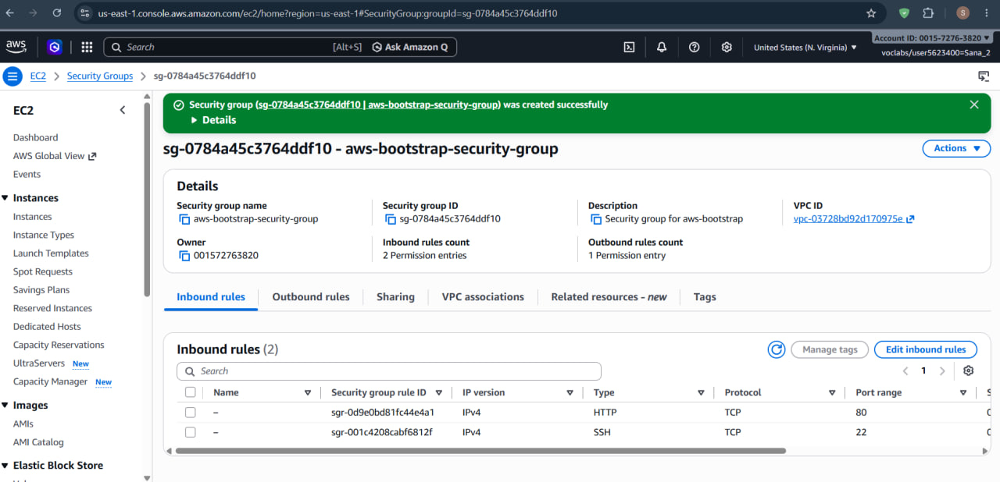
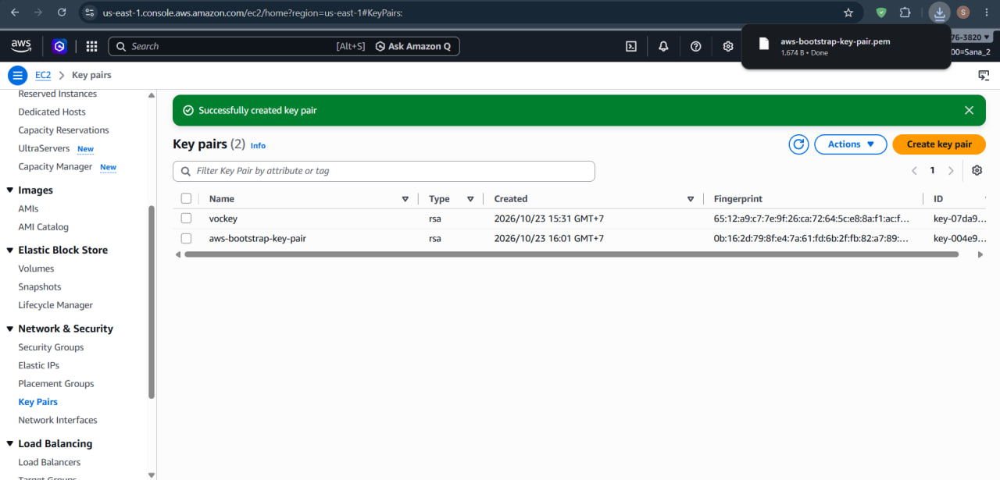
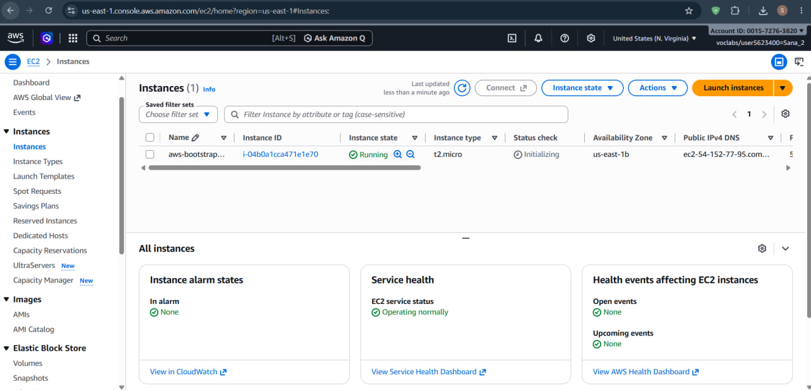
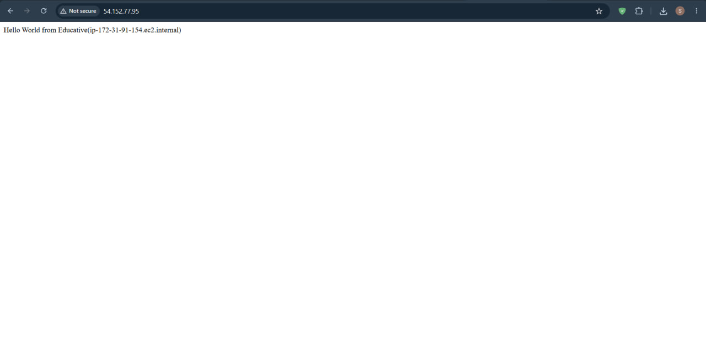
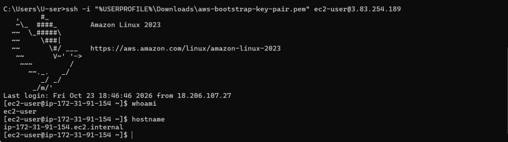
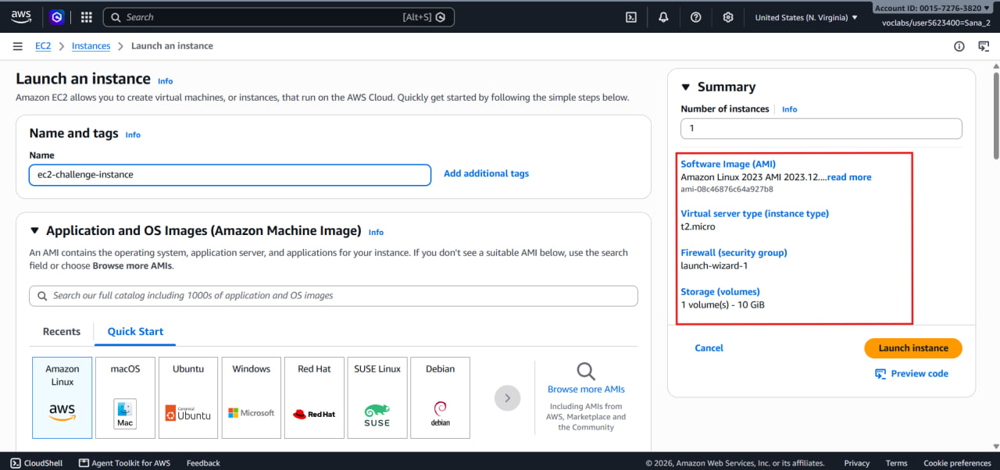
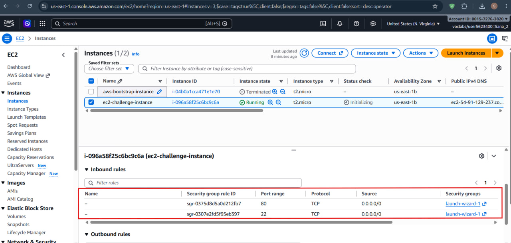
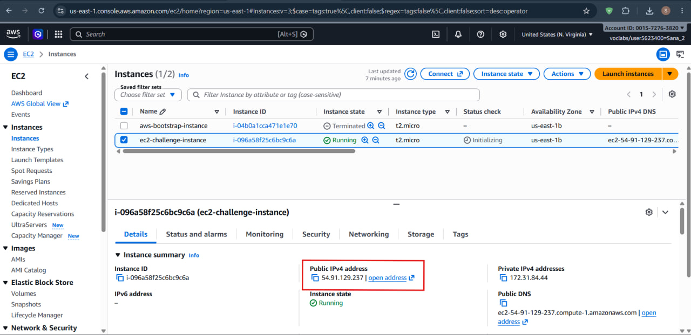
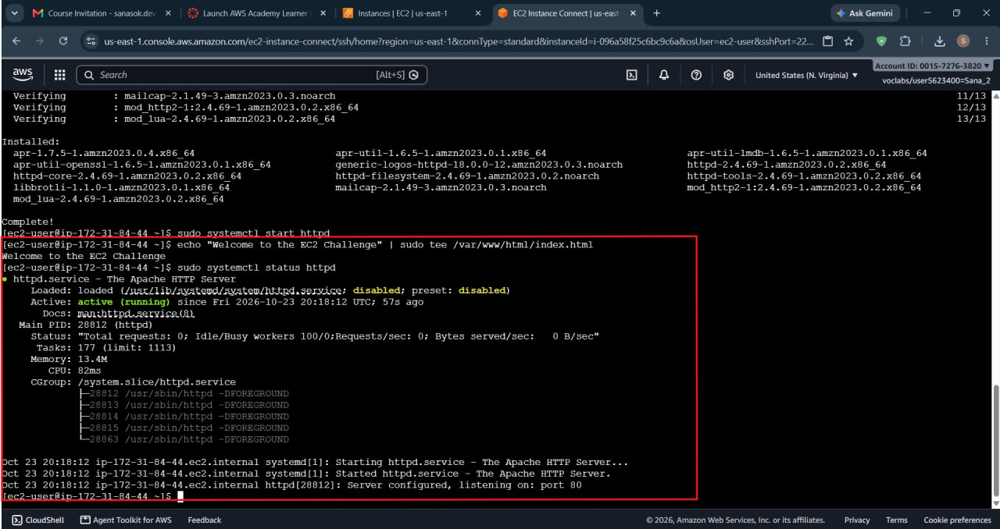
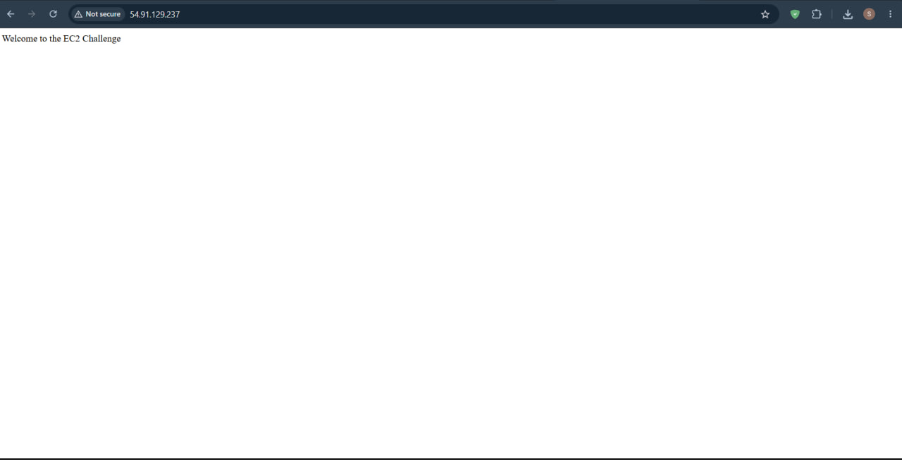

# Cloud Computing - Lab 1: Amazon EC2

- **Student ID**: e20220671
- **Course**: Cloud Computing

---

## Part 1.1: AWS Bootstrap Instance

### 1. Security Group Configuration
Inbound rules configured for HTTP (port 80) and SSH (port 22).



### 2. Key Pair Creation
Key pair generated for secure SSH authentication.



### 3. Instance Details
Details of the launched `aws-bootstrap-instance` showing state and public IP.



### 4. Approach 1 — Browser Test
Testing the bootstrap web server via HTTP browser navigation.



### 5. Approach 2 — SSH Connection
Connecting to the instance via terminal and verifying with `whoami` and `hostname`.



---

## Part 1.2: EC2 Challenge

### 1. Requirements Summary
- **Instance Type**: `t2.micro` (Linux)
- **Public IP**: Enabled
- **Security Group**: Inbound rules for HTTP (port 80) and SSH (port 22)
- **Storage**: Root volume sized at 10 GiB
- **Web Server**: Apache (`httpd`) serving static message *"Welcome to the EC2 Challenge"*

### 2. Launch Configuration
Launch configuration showing `t2.micro`, AMI, and 10 GiB storage volume.



### 3. Security Group
Security group allowing inbound HTTP (80) and SSH (22) from `0.0.0.0/0`.



### 4. Running Instance
EC2 management console showing the challenge instance running with Public IPv4 assigned.



### 5. Commands Executed on Instance

```bash
# Update package repositories
sudo dnf update -y

# Install Apache Web Server
sudo dnf install -y httpd

# Start and enable the Apache service
sudo systemctl start httpd
sudo systemctl enable httpd

# Create the challenge static web page
echo "Welcome to the EC2 Challenge" | sudo tee /var/www/html/index.html

# Verify Apache service status
sudo systemctl status httpd
```



### 6. Browser Verification
Verifying the deployed web page in the browser via `http://<Public-IP>`.


