# Cloud Computing - Lab 2: Elastic Load Balancing & Auto Scaling

- **Student ID**: e20220671
- **Course**: Cloud Computing

---

## 1. Security Groups Configuration

### 1.1 Load Balancer Security Group
Created `LoadBalancerSecurityGroup` (`sg-06ae62d90bd1b43a1`) to allow inbound HTTP (port 80) traffic to the Application Load Balancer.

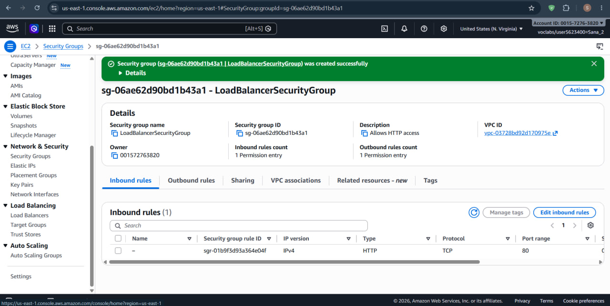

### 1.2 Launch Template Security Group
Created `LaunchTemplateSecurityGroup` (`sg-01fa0c430f1c2f21b`) to allow inbound HTTP (port 80) and SSH (port 22) access to the EC2 instances.

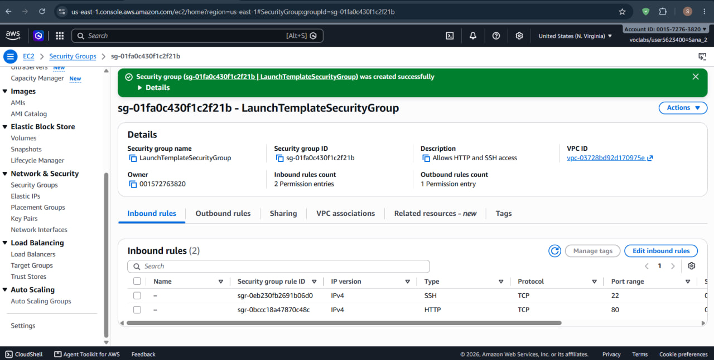

---

## 2. Target Group Configuration

### 2.1 Target Group Details
Created target group `LoadBalancerTargetGroup` with target type `Instance` on `HTTP: 80` (IPv4).

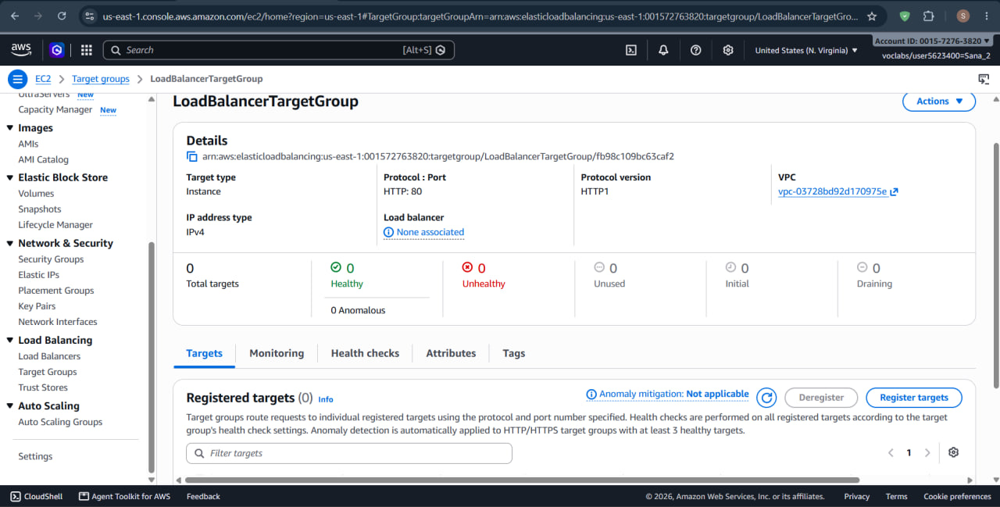

### 2.2 Health Checks Configuration
Configured health check settings on `LoadBalancerTargetGroup`:
- **Protocol**: `HTTP`
- **Path**: `/`
- **Healthy threshold**: `5` consecutive health check successes
- **Unhealthy threshold**: `2` consecutive health check failures
- **Timeout**: `5 seconds`
- **Interval**: `30 seconds`
- **Success codes**: `200`

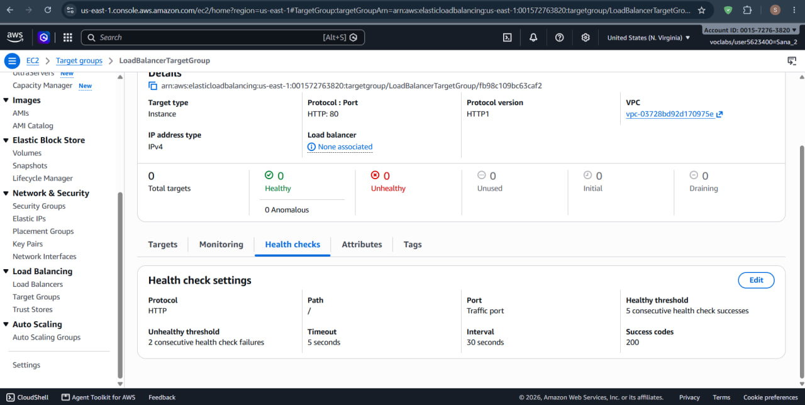

---

## 3. Application Load Balancer (ALB)

### 3.1 Load Balancer Overview
Provisioned internet-facing Application Load Balancer `MyLoadBalancer` (`MyLoadBalancer-709641203.us-east-1.elb.amazonaws.com`) across the VPC availability zones.

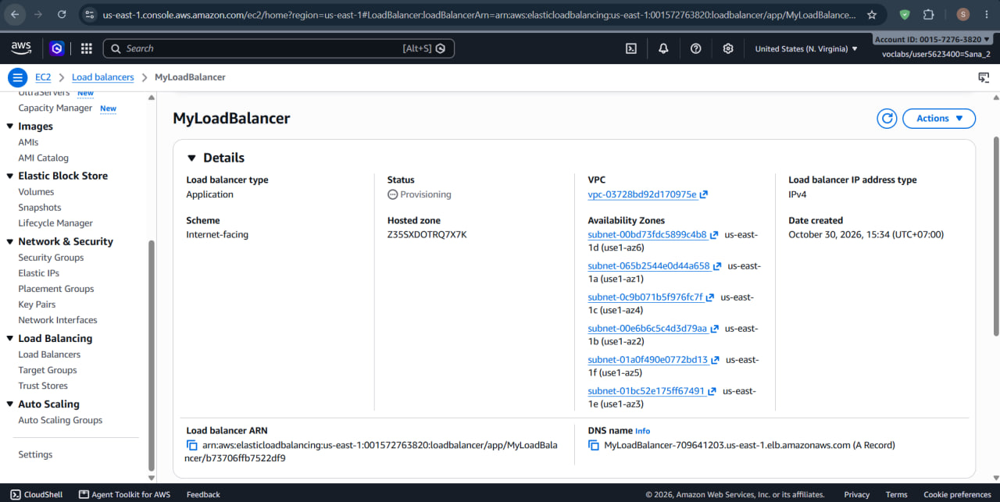

### 3.2 Load Balancer Security & Details
Detailed view of `MyLoadBalancer` showing the attached `LoadBalancerSecurityGroup` (`sg-06ae62d90bd1b43a1`).

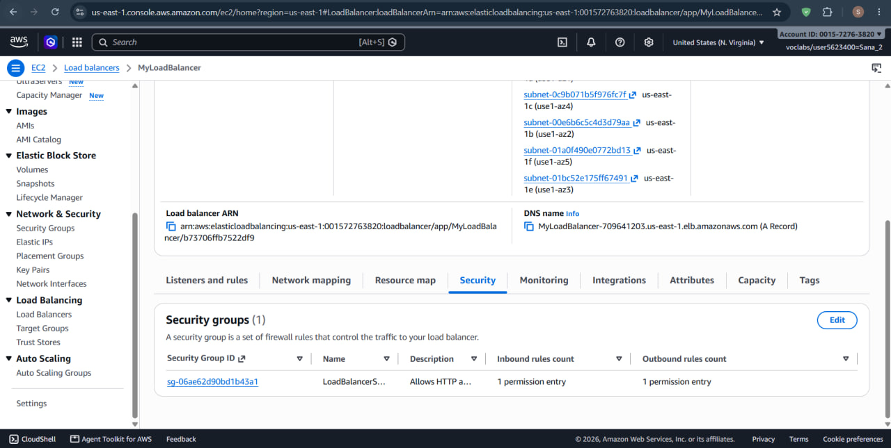

---

## 4. Launch Template & Auto Scaling Group (ASG)

### 4.1 Launch Template
Created launch template `AutoScalingLaunchTemplate` (`lt-07c345ed699ec7d43`) configured with Amazon Linux 2023 AMI (`ami-073f45061d35c86f0`), instance type `t2.micro`, security group `LaunchTemplateSecurityGroup`, and user data script to bootstrap Apache (`httpd`):

```bash
#!/bin/bash
dnf update -y
dnf install -y httpd
systemctl start httpd
systemctl enable httpd
echo "Hello World from ($(hostname -f))" > /var/www/html/index.html
```

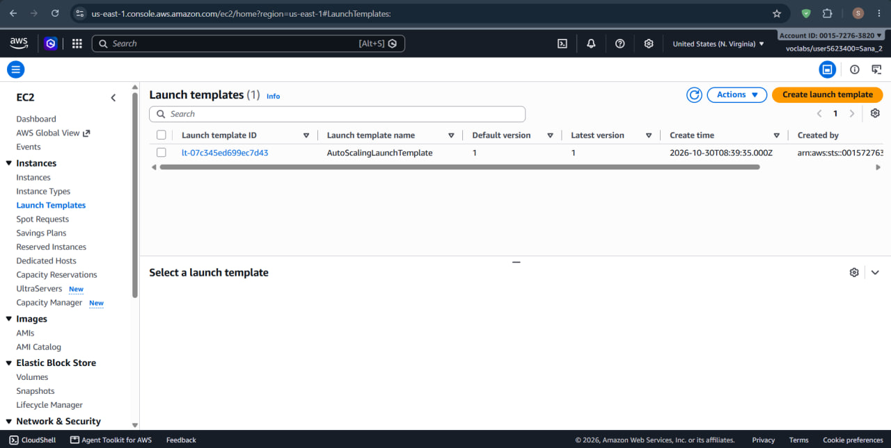

### 4.2 Auto Scaling Group List
Created Auto Scaling Group `MyAutoScalingGroup` using `AutoScalingLaunchTemplate` with:
- **Desired capacity**: `2`
- **Min capacity**: `2`
- **Max capacity**: `3`

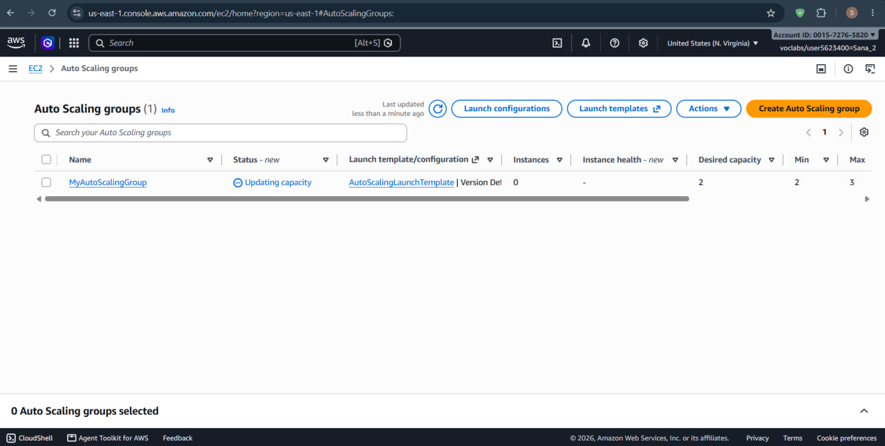

### 4.3 Auto Scaling Group Details
Detailed configuration of `MyAutoScalingGroup` showing capacity status (`At desired capacity`) and associated launch template details.

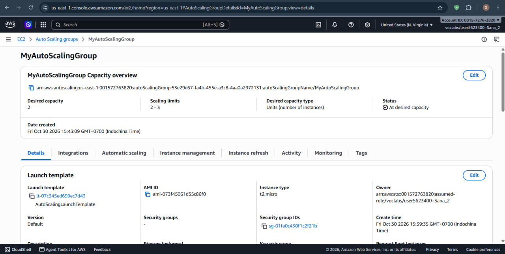

---

## 5. Load Balancing Verification

### 5.1 Browser Test — Instance 1
Accessing the Load Balancer DNS URL (`http://myloadbalancer-709641203.us-east-1.elb.amazonaws.com`), returning response from the first EC2 instance (`ip-172-31-94-96.ec2.internal`):

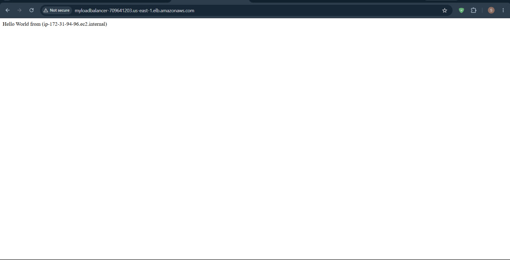

### 5.2 Browser Test — Instance 2
Refreshing the Load Balancer DNS URL, demonstrating round-robin traffic distribution to the second EC2 instance (`ip-172-31-0-135.ec2.internal`):

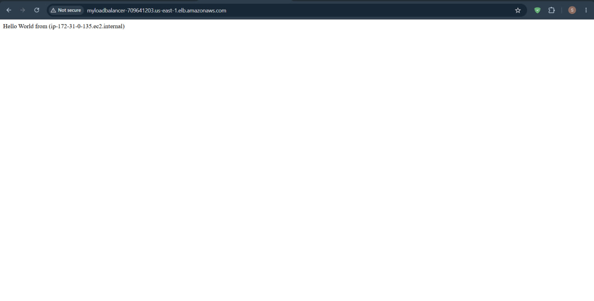

---

## 6. High Availability & Self-Healing Test

### 6.1 Stopping Apache Service (`httpd`)
Connected to instance `i-0525dc1d690e60df2` (`ip-172-31-94-96`) via EC2 Instance Connect and stopped the Apache service to simulate a failure:

```bash
sudo systemctl stop httpd.service
```

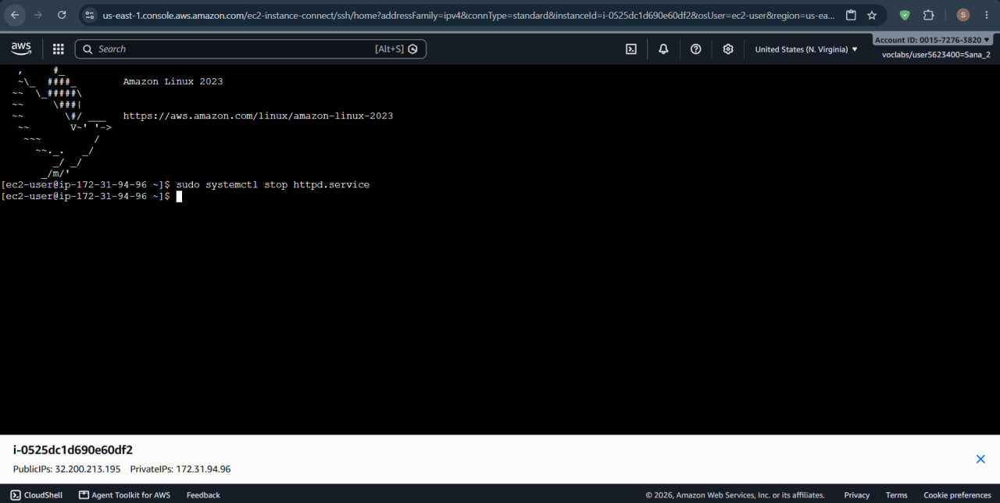

### 6.2 Unhealthy Target Detection
Target group `LoadBalancerTargetGroup` health checks detecting the failure (`Health checks failed` / `Draining` during target deregistration).

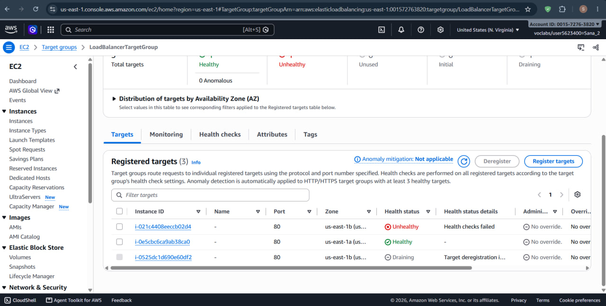

### 6.3 Automatic Instance Replacement
Auto Scaling Group automatically replacing the failed instance and restoring `LoadBalancerTargetGroup` to `2` healthy targets (`i-021c4408eeccb02d4` and `i-0e5cbc6ca9ab38ca0`).

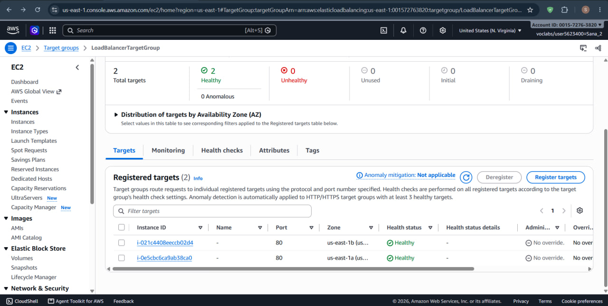
